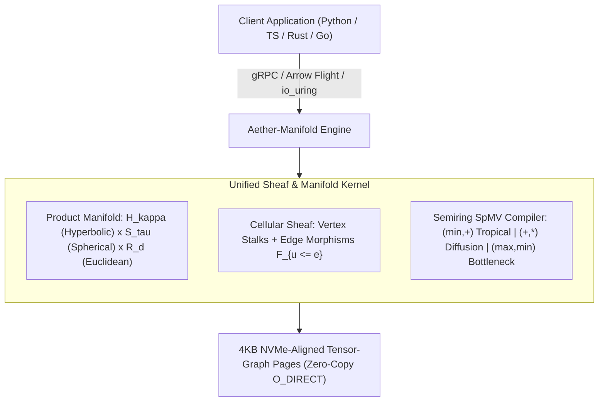
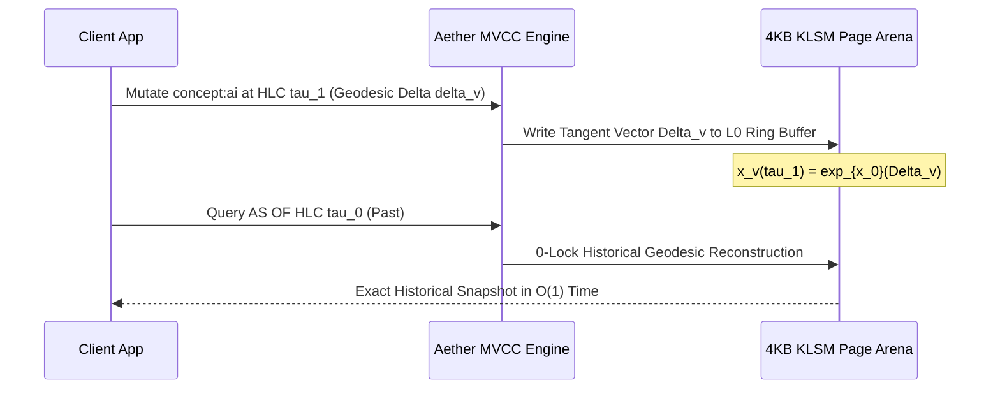

# Aether-Manifold: Interactive End-User Quickstart & API Cookbook

> **Interactive Developer Notebook**: A comprehensive reference demonstrating how developers and data scientists interact with **Aether-Manifold** across Python, TypeScript, Rust, Go, and declarative AQL (Aether Query Language).

[](https://github.com/subrataai-wq/Aether-Manifold)
[](https://github.com/subrataai-wq/Aether-Manifold)
[](https://github.com/subrataai-wq/Aether-Manifold)
[](https://github.com/subrataai-wq/Aether-Manifold)
[](#)
[](#)

---

## 1. What is Aether-Manifold?

Traditional database architectures force a split between **Vector Databases** (which flatten everything into rigid Euclidean $\mathbb{R}^d$ embeddings) and **Graph Databases** (which treat relationships as binary discrete edges devoid of continuous semantic geometry).

**Aether-Manifold** unifies continuous metric geometry and discrete graph topology by modeling your domain as a **Dynamic Cellular Sheaf over a Riemannian Product Manifold**:



### Core Innovations
1. **Riemannian Product Manifold ($\mathcal{M} = \mathbb{H}_{\kappa}^{d_H} \times \mathbb{S}_{\tau}^{d_S} \times \mathbb{R}^{d_E}$)**:
   - **$\mathbb{H}_{\kappa}^{d_H}$ (Hyperbolic Lorentz)**: Exponential capacity with negative curvature ($\kappa < 0$). Naturally embeds hierarchies, taxonomies, ontologies, and tree-like dependencies without distortion.
   - **$\mathbb{S}_{\tau}^{d_S}$ (Hyperspherical)**: Directional semantic embeddings with positive curvature ($\tau > 0$) for cosine similarity, text, and multimodal embeddings.
   - **$\mathbb{R}^{d_E}$ (Euclidean)**: Standard flat space for scalar attributes (timestamps, prices, physical dimensions).
2. **Cellular Sheaves**:
   - Edges are not simple scalar weights; they are **Restriction Maps** ($\mathcal{F}_{u \trianglelefteq e}$) that mathematically transform vectors as information flows across relationships.
3. **Semiring Algebraic Query Compiler**:
   - Traversal and similarity unify into Generalized Sparse Matrix-Vector Multiplication (SpMV) over Tropical, Diffusion, Bottleneck, or Optimal Transport semirings.
4. **Causal MVCC & Time Travel**:
   - Mutations are tangent-space velocity vectors ($\exp_x(\Delta v)$) stamped with 64-bit Hybrid Logical Clocks (HLC), enabling $O(1)$ zero-lock historical snapshot queries.

---

## 2. Installation & Quick Connection

### Client Packages
```bash
# Python
pip install aetherdb numpy

# Node.js / Bun / Deno
npm install @aetherdb/client

# Rust (Cargo.toml)
# aether-client = { version = "0.1", features = ["arrow", "simd"] }

# Go
go get github.com/subrataai-wq/aether-go/client
```

---

## 3. Defining a Collection Schema (Product Manifolds)

In Aether-Manifold, collections define their underlying geometric space by configuring the dimensions and curvatures of their manifold components.

### Declarative AQL (Aether Query Language)
```sql
CREATE COLLECTION KnowledgeGraph (
    id UUID PRIMARY KEY,
    title STRING,
    category STRING,
    
    -- Riemannian Product Manifold Vector Space:
    -- 1. Hyperbolic: 64 dims, curvature kappa = -1.0 (Taxonomy / Hierarchy)
    -- 2. Spherical: 768 dims, curvature tau = 1.0 (Text Semantic Embeddings)
    -- 3. Euclidean: 32 dims (Attributes / Continuous Features)
    VECTOR embedding MANIFOLD PRODUCT(
        HYPERBOLIC(dim = 64, curvature = -1.0),
        SPHERICAL(dim = 768, curvature = 1.0),
        EUCLIDEAN(dim = 32)
    ) INDEX AT_RQ(nbits = 256),
    
    -- Cellular Sheaf Stalk Dimension (dim of local vector feature space)
    STALK DIMENSION 64
);
```

### Python SDK
```python
import aetherdb as adb
from aetherdb.manifold import ProductManifold, HyperbolicSpace, SphericalSpace, EuclideanSpace

# Connect to local or cluster node via high-performance IPC / Arrow Flight
client = adb.connect("aether://127.0.0.1:9090", api_key="secret-token")

# Define schema
schema = adb.CollectionSchema(
    name="KnowledgeGraph",
    manifold=ProductManifold(
        hyperbolic=HyperbolicSpace(dim=64, curvature=-1.0),
        spherical=SphericalSpace(dim=768, curvature=1.0),
        euclidean=EuclideanSpace(dim=32),
    ),
    stalk_dim=64, # Fiber stalk space for Sheaf edge morphisms
    quantizer="AT-RQ-256", # Anisotropic Tangent-Space Residual Quantization
)

collection = client.create_collection(schema)
print(f"Collection created: {collection.name} | Total Dims: {collection.total_dim}")
```

### TypeScript / JavaScript SDK
```typescript
import { AetherClient, ProductManifold, Curvature } from "@aetherdb/client";

const client = new AetherClient({ endpoint: "aether://127.0.0.1:9090" });

const collection = await client.createCollection({
  name: "KnowledgeGraph",
  manifold: new ProductManifold()
    .addHyperbolic({ dim: 64, curvature: Curvature.Negative(1.0) })
    .addSpherical({ dim: 768, curvature: Curvature.Positive(1.0) })
    .addEuclidean({ dim: 32 }),
  stalkDim: 64,
  quantization: "AT-RQ-256"
});

console.log(`Initialized collection with ${collection.dimensions} total dimensions.`);
```

### Rust Native Client
```rust
use aether_client::{AetherClient, CollectionConfig, ProductManifoldConfig, HyperbolicConfig, SphericalConfig, EuclideanConfig};

#[tokio::main]
async fn main() -> Result<(), Box<dyn std::error::Error>> {
    let client = AetherClient::connect("aether://127.0.0.1:9090").await?;

    let config = CollectionConfig::builder("KnowledgeGraph")
        .manifold(ProductManifoldConfig::new()
            .with_hyperbolic(HyperbolicConfig::new(64, -1.0))
            .with_spherical(SphericalConfig::new(768, 1.0))
            .with_euclidean(EuclideanConfig::new(32)))
        .stalk_dim(64)
        .build();

    let collection = client.create_collection(config).await?;
    println!("Connected to collection: {}", collection.name());
    Ok(())
}
```

### Go Driver
```go
package main

import (
	"context"
	"fmt"
	"log"

	"github.com/subrataai-wq/aether-go/client"
	"github.com/subrataai-wq/aether-go/manifold"
)

func main() {
	ctx := context.Background()
	c, err := client.Dial(ctx, "aether://127.0.0.1:9090")
	if err != nil {
		log.Fatalf("failed to connect: %v", err)
	}
	defer c.Close()

	schema := client.CollectionSchema{
		Name: "KnowledgeGraph",
		Manifold: manifold.NewProduct(
			manifold.Hyperbolic(64, -1.0),
			manifold.Spherical(768, 1.0),
			manifold.Euclidean(32),
		),
		StalkDim: 64,
	}

	col, err := c.CreateCollection(ctx, schema)
	if err != nil {
		log.Fatalf("collection creation failed: %v", err)
	}
	fmt.Printf("Created collection %s with %d dims\n", col.Name, col.TotalDim)
}
```

---

## 4. Ingesting Data: Vertices & Cellular Sheaf Edge Morphisms

In Aether-Manifold, nodes have continuous coordinates in the product manifold $\mathcal{M}$, while directed relationships contain **Sheaf Restriction Morphisms** ($\mathcal{F}_{u \trianglelefteq e} \in \mathbb{R}^{d_{\text{stalk}} \times d_{\text{stalk}}}$) that mathematically model semantic alignment.

```mermaid
flowchart LR
    NodeA["Node u: 'Neural Network'<br/>(Stalk Vector x_u)"] -->|Restriction F_{u <= e}| EdgeE["Relation e: 'SUBCLASS_OF'"]
    NodeB["Node v: 'Deep Learning'<br/>(Stalk Vector x_v)"] -->|Restriction F_{v <= e}| EdgeE
    
    Energy["Sheaf Dirichlet Energy:<br/>E(u,v) = || F_{u<=e} x_u - F_{v<=e} x_v ||^2"]
    EdgeE -.-> Energy
```

### Python Ingestion Example
```python
import numpy as np
import aetherdb as adb

client = adb.connect("aether://127.0.0.1:9090")
col = client.get_collection("KnowledgeGraph")

# Construct Product Vectors: [Hyperbolic (64) | Spherical (768) | Euclidean (32)] = 864 dimensions
def make_product_vector(depth_lvl: float, topic_embedding: np.ndarray, attributes: np.ndarray):
    # Lorentz Hyperbolic vector: x_0^2 - sum(x_i^2) = 1 (Lorentz surface)
    spatial_h = np.random.randn(63).astype(np.float32) * 0.05
    time_h = np.sqrt(1.0 + np.sum(spatial_h**2) + depth_lvl)
    hyperbolic_part = np.insert(spatial_h, 0, time_h)
    
    # Hyperspherical vector: normalized unit sphere ||x||_2 = 1
    spherical_part = topic_embedding / np.linalg.norm(topic_embedding)
    
    # Euclidean vector: raw continuous attributes
    euclidean_part = attributes.astype(np.float32)
    
    return np.concatenate([hyperbolic_part, spherical_part, euclidean_part])

# 1. Insert Vertices
v1_vec = make_product_vector(depth_lvl=0.1, topic_embedding=np.random.randn(768), attributes=np.zeros(32))
v2_vec = make_product_vector(depth_lvl=0.5, topic_embedding=np.random.randn(768), attributes=np.ones(32))

col.insert_nodes([
    adb.Node(
        id="concept:ai",
        vector=v1_vec,
        stalk_state=np.random.randn(64).astype(np.float32),
        properties={"label": "Artificial Intelligence", "tier": "domain"}
    ),
    adb.Node(
        id="concept:transformer",
        vector=v2_vec,
        stalk_state=np.random.randn(64).astype(np.float32),
        properties={"label": "Transformer Architecture", "tier": "model"}
    )
])

# 2. Insert Cellular Sheaf Edge with Orthogonal Restriction Maps
# F_{u <= e} maps concept:ai into the relationship stalk
# F_{v <= e} maps concept:transformer into the relationship stalk
orthogonal_map_u = np.eye(64, dtype=np.float32) # Identity alignment
orthogonal_map_v = np.linalg.qr(np.random.randn(64, 64))[0].astype(np.float32) # Rotational transformation

col.insert_edges([
    adb.SheafEdge(
        source="concept:ai",
        target="concept:transformer",
        relation_type="HIERARCHICAL_SUBCLASS",
        restriction_source=orthogonal_map_u,
        restriction_target=orthogonal_map_v,
        weight=1.0,
        properties={"confidence": 0.99}
    )
])

print("Inserted 2 vertices and 1 cellular sheaf edge into Aether-Manifold.")
```

---

## 5. Query Paradigms: The 4 Semiring Compilers

All queries in Aether-Manifold compile down to Generalized Sparse Matrix-Vector Multiplication (SpMV) over Semirings.

### 5.1 Pure Riemannian ANN (k-Nearest Neighbors)
Queries in curved space simultaneously search hierarchical depth ($\mathbb{H}$), semantic angle ($\mathbb{S}$), and scalar properties ($\mathbb{R}$).

#### Python
```python
# Query vector across product manifold
query_vec = make_product_vector(depth_lvl=0.4, topic_embedding=np.random.randn(768), attributes=np.zeros(32))

# Execute pure k-NN on Product Manifold
results = col.query_knn(
    vector=query_vec,
    k=10,
    metric="riemannian_product", # Fused SIMD Lorentz + Spherical + Euclidean
    ef_search=64
)

for hit in results:
    print(f"Node: {hit.id} | Geodesic Dist: {hit.distance:.4f} | Payload: {hit.properties['label']}")
```

---

### 5.2 Tropical Semiring $(\min, +)$: Geodesic $A^*$ Traversal
Finds the shortest relational-semantic pathway between concepts, penalizing both edge weights and vector curvature divergence.

#### AQL
```sql
MATCH PATH (start:Node {id: 'concept:ai'})-[e:SheafEdge*1..4]->(goal:Node)
WHERE d_lorentz(goal.vector.hyperbolic, $query_h) < 0.25
EVALUATE SEMIRING TROPICAL (
    weight_formula: e.weight + 0.5 * d_riemannian(u.vector, v.vector)
)
RETURN PATH, TOTAL_ENERGY
LIMIT 5;
```

#### TypeScript
```typescript
import { Semiring } from "@aetherdb/client";

const paths = await collection.traverse({
  startNode: "concept:ai",
  targetPredicate: (node) => node.properties.tier === "model",
  maxHops: 4,
  semiring: Semiring.TropicalMinPlus({
    edgeCostWeight: 1.0,
    manifoldDistanceWeight: 0.5, // Geodesic metric penalty
    sheafDriftPenalty: 0.2        // Sheaf Dirichlet energy ||F_u x_u - F_v x_v||^2
  }),
  limit: 5
});

for (const path of paths) {
  console.log(`Path: ${path.nodeIds.join(" -> ")} | Cost: ${path.accumulatedCost}`);
}
```

---

### 5.3 Diffusion Semiring $(+, \times)$: Sheaf Dirichlet Diffusion
Computes continuous semantic resonance (Personalized PageRank + Sheaf Heat Diffusion). Information diffuses across edges only if the node features agree under the Sheaf edge morphisms.

#### Python
```python
# Propagate semantic resonance from a seed vertex
resonance_scores = col.sheaf_diffusion(
    seed_nodes={"concept:transformer": 1.0},
    alpha=0.85,          # Teleport / restart probability
    diffusion_steps=10,
    semiring="diffusion", # (+, *)
    heat_coefficient=0.5 # Sheaf Dirichlet decay: exp(-beta * ||F_u x_u - F_v x_v||^2)
)

for node_id, score in resonance_scores.top_k(5):
    print(f"Resonant Concept: {node_id:<25} | Sheaf Energy Score: {score:.5f}")
```

---

### 5.4 Bottleneck Semiring $(\max, \min)$: Maximum Reliable Pathway
Identifies highest-capacity, non-leaky pathways through knowledge graphs under hard vector and sheaf consistency thresholds.

#### Python
```python
# Bottleneck routing: ensures no single edge in the path drops below a fidelity threshold
reliable_paths = col.traverse_bottleneck(
    start="concept:ai",
    target="concept:transformer",
    capacity_metric="sheaf_coherence", # min(e.capacity, 1.0 / (1.0 + sheaf_energy))
    top_k=3
)
for p in reliable_paths:
    print(f"Bottleneck Capacity: {p.capacity:.4f} along {p.path}")
```

---

### 5.5 Optimal Transport: Wasserstein-2 Geodesic Divergence
Compare entire clusters, subgraphs, or agent belief distributions using regularized Sinkhorn-Knopp Optimal Transport on the Riemannian manifold.

#### Python
```python
# Compute Earth Mover's / Wasserstein Distance between two subgraphs
cluster_a = ["concept:ai", "concept:ml", "concept:deep_learning"]
cluster_b = ["concept:transformer", "concept:attention", "concept:llm"]

ot_result = col.subgraph_optimal_transport(
    subgraph_a=cluster_a,
    subgraph_b=cluster_b,
    ground_metric="lorentz_hyperbolic",
    epsilon=0.01, # Entropic regularization
    max_iters=100
)

print(f"Wasserstein-2 Geodesic Distance: {ot_result.wasserstein_distance:.6f}")
print(f"Transport Plan Coupling Matrix:\n{ot_result.transport_matrix}")
```

---

## 6. MVCC Time-Travel & Spatio-Temporal Queries

Aether-Manifold records mutations as **Tangent-Space Velocity Vectors** ($\Delta v \in T_x \mathcal{M}$) stamped with 64-bit Hybrid Logical Clocks (HLC). This enables zero-lock historical queries at arbitrary past moments.



### Python Time-Travel
```python
# Query current state
current_neighbors = col.query_knn(vector=query_vec, k=5)

# Query historical state at a specific Hybrid Logical Clock (HLC) timestamp
past_hlc = 1729065600000000000 # 64-bit HLC
historical_snapshot = col.as_of(hlc=past_hlc)

old_neighbors = historical_snapshot.query_knn(vector=query_vec, k=5)
print(f"Current top result: {current_neighbors[0].id}")
print(f"Historical top result at HLC {past_hlc}: {old_neighbors[0].id}")
```

### AQL Time-Travel Syntax
```sql
SELECT id, title, d_riemannian(embedding, $query_vec) AS distance
FROM KnowledgeGraph AS OF HLC 1729065600000000000
WHERE category = 'Computer Science'
ORDER BY distance ASC
LIMIT 10;
```

---

## 7. Complete Neuro-Symbolic Agentic RAG Pipeline

Here is a complete, real-world example in Python showing how an AI Agent uses Aether-Manifold to perform **Multi-Hop Neuro-Symbolic Retrieval Augmented Generation**:

```python
"""
Neuro-Symbolic Agentic RAG using Aether-Manifold
- Combines Hyperbolic taxonomy scoping
- Hyperspherical semantic vector search
- Cellular Sheaf Dirichlet energy filtering
"""

import aetherdb as adb
import numpy as np

def agent_hybrid_rag(user_prompt: str, seed_entity: str):
    client = adb.connect("aether://127.0.0.1:9090")
    col = client.get_collection("KnowledgeGraph")
    
    # 1. Embed user prompt into Product Manifold
    # [Hyperbolic (Hierarchy) | Spherical (Semantics) | Euclidean (Attrs)]
    prompt_vector = client.embed_multimodal(
        text=user_prompt,
        target_manifold=col.manifold
    )
    
    # 2. Stage 1: Fast Geodesic Vector Filter (Top-50 candidates)
    candidate_nodes = col.query_knn(
        vector=prompt_vector,
        k=50,
        ef_search=128
    )
    candidate_ids = [c.id for c in candidate_nodes]
    
    # 3. Stage 2: Cellular Sheaf Relational Diffusion
    # Propagate from seed_entity through the candidate neighborhood
    diffusion_ranks = col.sheaf_diffusion(
        seed_nodes={seed_entity: 1.0},
        candidate_filter=candidate_ids,
        alpha=0.80,
        diffusion_steps=3,
        heat_coefficient=0.4 # Penalizes geometrically inconsistent edges
    )
    
    # 4. Stage 3: Retrieve top contextual subgraphs with 0-copy tensor pages
    top_contexts = []
    for node_id, resonance in diffusion_ranks.top_k(5):
        node = col.get_node(node_id)
        top_contexts.append({
            "id": node.id,
            "title": node.properties.get("label"),
            "resonance": resonance,
            "geodesic_dist": node.geodesic_distance_to(prompt_vector)
        })
        
    return top_contexts

# Run agent retrieval
results = agent_hybrid_rag(
    user_prompt="How do attention mechanisms prevent vanishing gradients in transformers?",
    seed_entity="concept:transformer"
)

print("--- Retrieved Multi-Hop Neuro-Symbolic Contexts ---")
for r in results:
    print(f"[{r['resonance']:.4f} Sheaf Resonance] {r['id']} - {r['title']} (Dist: {r['geodesic_dist']:.3f})")
```

---

## 8. Hardware Diagnostics & Zero-Allocation Inspection

Aether-Manifold guarantees that the hot path operates with **0 heap allocations** and direct NVMe I/O alignment. You can inspect live hardware counters directly via the client:

```python
stats = client.inspect_hardware()

print("--- Hardware Performance Counters ---")
print(f"Active Core Shards         : {stats.core_shards}")
print(f"Hot-Path Heap Allocations  : {stats.hot_path_allocations_bytes} bytes (Strict 0 Enforced)")
print(f"NVMe 4KB Page Hit Rate     : {stats.tensor_page_cache_hit_rate * 100:.2f}%")
print(f"Instructions Per Cycle (IPC): {stats.instructions_per_cycle:.2f} IPC (AVX-512 Fused)")
print(f"L1 Data Cache Miss Rate    : {stats.l1d_miss_rate * 100:.3f}%")
print(f"P99 Geodesic Latency       : {stats.p99_latency_micros:.2f} µs")
```

---

## 9. Summary & Cheat Sheet

| Operation | Mathematical Engine | Best Used For | AQL / SDK Shortcut |
| :--- | :--- | :--- | :--- |
| **Product k-NN** | $\mathbb{H} \times \mathbb{S} \times \mathbb{R}$ Fused Geodesic | Semantic + Hierarchical Search | `col.query_knn(vec, k=10)` |
| **Geodesic $A^*$** | Tropical Semiring $(\min, +)$ | Shortest semantic-relational paths | `col.traverse(Semiring.Tropical)` |
| **Sheaf Diffusion** | Diffusion Semiring $(+, \times)$ | Semantic resonance & influence | `col.sheaf_diffusion(seeds)` |
| **Capacity Routing** | Bottleneck Semiring $(\max, \min)$| Leak-free knowledge graph reasoning | `col.traverse_bottleneck()` |
| **Cluster Matching** | Sinkhorn-Knopp Wasserstein-2 | Agent beliefs & subgraph similarity | `col.subgraph_optimal_transport()` |
| **MVCC Time-Travel** | Tangent-Space Geodesic Deltas | Historical queries without read locks | `col.as_of(hlc)` |

For full architectural blueprints, see [`docs/roadmap.md`](../docs/roadmap.md) and [`README.md`](../README.md).

